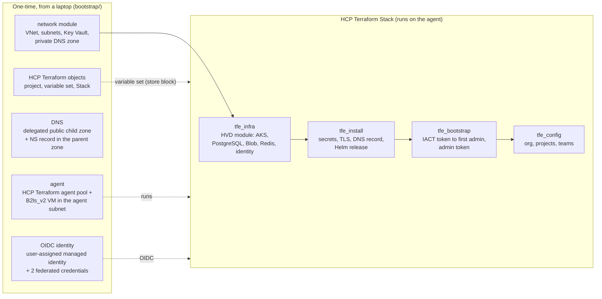

# tf-azure-aks-TFE

Terraform that builds a small AKS cluster in Azure, installs Terraform Enterprise (TFE) 2.0.8 on it, and configures TFE. It runs as an HCP Terraform Stack on an HCP Terraform agent inside the Azure VNet. Every layer is also a plain module you can run from the CLI or Azure DevOps.

It is a reference implementation. The default `lab` preset is small and cost-sensitive; the `small` and `production` presets are described in [docs/architecture.md](docs/architecture.md). See [docs/production.md](docs/production.md) for what to change before production.

**New AKS only: using an existing AKS cluster is not supported yet.**

## Disclaimer

This repository is provided as-is, without warranty or support. It is a reference implementation; review and test it before production use. It is not an official HashiCorp or IBM product.

## Prerequisites

- An Azure subscription where you are Owner (bootstrap creates role assignments), and Azure CLI logged in.
- A public Azure DNS zone you control (bootstrap adds one NS delegation record to it).
- A Terraform Enterprise licence file (`.hclic`).
- An HCP Terraform organisation with Stacks enabled and a token exported as `TFE_TOKEN` (Stack path only).
- A GitHub connection for the Stack (GitHub App or OAuth), Terraform 1.13 or later, and enough vCPU quota in your region (see the [runbook](docs/runbook.md)).

## Architecture



The network and DNS diagrams, and a component table, are in [docs/architecture.md](docs/architecture.md).

## Quick start

Full steps, with commands, are in the [runbook](docs/runbook.md).

### Stack path

1. **Bootstrap** (once, from your laptop): `cp terraform.tfvars.example terraform.tfvars` in `bootstrap/`, fill it in, then `terraform init && terraform apply`. This builds the network, Key Vault, DNS, identity, agent VM and the HCP Terraform project, variable set and Stack. See [bootstrap/README.md](bootstrap/README.md).
2. **Edit the template**: review `deployments.tfdeploy.hcl` (AKS version, emails, organisation name; each value to change is commented). Keep `deployment_name` and the variable set name in step with bootstrap.
3. **Pass 1**: with `configure_tfe = false`, push and approve the plan in HCP Terraform. It builds AKS, installs TFE and creates the first admin.
4. **Pass 2**: once `tfe_bootstrap` has applied, set `configure_tfe = true`, push and approve. `tfe_config` then creates the organisation, projects and team.
5. **Acceptance**: `./scripts/acceptance.sh --rg <rg> --aks <aks-name> --hostname <fqdn> --key-vault <name> --org <org>`.
6. **Destroy**: set `destroy = true` on `deployment "main"` and approve, then `terraform -chdir=bootstrap destroy`.
7. **Optional demo VPN**: `enable_demo_vpn = true` in bootstrap, then `./scripts/demo-vpn-profile.sh`, to open the private TFE URL from your laptop (about A$0.60/h while on). See the [runbook](docs/runbook.md#demo-access-through-vpn-optional).

### CLI path (no Stack)

Run the same modules as three plain roots: [examples/cli/README.md](examples/cli/README.md). The CLI path does not create the network or Key Vault. Take them from `modules/network` (the `01-infra` example can use it) or from the bootstrap outputs, and run `02-app` and `03-config` from a machine that can reach the private network.

## Cost (`lab` preset)

Azure retail list prices, Australia East, AUD, before GST.

| | |
|---|---|
| AKS, PostgreSQL, 2 x Redis (`lab`) | about A$1.3 to 1.5 an hour |
| Agent VM (`Standard_B2ls_v2`; some subscriptions restrict B-series SKUs, so check availability) | about A$0.08 an hour (A$55 to A$64 a month) |
| Small items (load balancer, IPs, endpoints, disks, Blob, DNS) | about A$50 to A$150 a month |
| A forgotten lab | about A$35 a day |

Bootstrap adds a budget alert on the resource group and `owner` and `expires` tags. The `small` and `production` presets and the full sizing table are in [docs/architecture.md](docs/architecture.md).

## Modules

| Module | What it does |
|---|---|
| [`modules/network`](modules/network/README.md) | VNet and subnets, Key Vault, database password secret, private DNS zone |
| [`modules/tfe-infra`](modules/tfe-infra/README.md) | Wraps the HVD module: AKS, PostgreSQL, Redis, Blob storage, workload identity |
| [`modules/tfe-install`](modules/tfe-install/README.md) | Secrets, Let's Encrypt certificate, private DNS record, Helm release |
| [`modules/tfe-bootstrap`](modules/tfe-bootstrap/README.md) | Creates the first admin once and stores the token in Key Vault |
| [`modules/tfe-config`](modules/tfe-config/README.md) | TFE organisation, projects and the `platform` team |

Other directories: `bootstrap/` (one-time laptop setup), `examples/cli/` (plain roots), `scripts/` (`test.sh`, `acceptance.sh`), `docs/`.

## Known gaps and security notes

- **No AKS network policy.** The HVD module 0.3.0 has no `network_policy` input, so trivy finding AZU-0043 is ignored in `.trivyignore`. This is a known gap.
- **Sample sign-in policy.** `modules/tfe-config` defaults `collaborator_auth_policy` to `two_factor_mandatory`. The sample Stack deployment and `examples/cli/03-config` set `"password"`, because the bootstrap admin's API token user has no 2FA. Moving to `two_factor_mandatory` needs every owner, including the bootstrap admin, to enrol 2FA first, or SSO.
- **Parent DNS zone.** Bootstrap creates a delegated child zone and writes one NS record in your parent zone, so the operator needs DNS Zone Contributor there (in whichever subscription it lives) at bootstrap apply and at destroy. Set `public_dns_zone_subscription_id` if the zone is in another subscription, or `create_lab_delegation = false` and add the NS record by hand if it is in another tenant. The agent VM identity can write to the child zone only.
- **Wiring check at plan review.** `terraform test` cannot see child-module resources, so the `tfe-infra` to HVD module wiring is checked by reading the first Stack plan. The runbook lists what to read.
- **AKS API exposure.** The sample keeps the AKS API public endpoint, limited to the agent VM's IP and `operator_cidrs`.
- **Vendored HVD module.** `modules/tfe-infra` uses HashiCorp's `terraform-enterprise-aks-hvd` 0.3.0, vendored in `vendor/terraform-enterprise-aks-hvd` with three patches listed in its `PATCHES.md`. Azure Managed Redis is created `NoCluster`, because Sidekiq can't use `EnterpriseCluster` (CROSSSLOT errors, runs stay pending). The federated credential uses the azurerm v5 attribute names, and an `aks_kube_config` output is added. Return to the registry module when it exposes the clustering policy.
- **HVD module and TFE 2.x differences found live.** The module's Helm template sets `TFE_OBJECT_STORAGE_AZURE_USE_MSI=true`, which breaks AKS workload identity on TFE 2.0.8 (the module sets it for a managed-identity path that does not work with workload identity here); `tfe-install` follows the TFE Kubernetes docs instead.
- **One deprecation warning left.** `storage_account_name` on the module's `azurerm_storage_container` is deprecated. Switching to `storage_account_id` may recreate the TFE blob container, so it stays until upstream changes it.
- **Stack identity.** The Stack identity has Contributor on its own resource group, plus Role Based Access Control Administrator limited by an ABAC condition to assigning only Network Contributor and Storage Blob Data Owner (it cannot grant Owner or other roles). The resource group still includes the agent VM, so a Stack run could run commands on the agent. For production, put the identity and the agent in separate resource groups.
- **`.trivyignore`.** It is repo-wide. Re-check AZU-0043 when support for using an existing AKS cluster is added.
- **Community module.** The HVD module is community-maintained. It is not covered by product support.

## Develop

Run `./scripts/check.sh` before pushing. It runs the same checks as CI: fmt, tflint, terraform-docs drift, trivy (if installed), unit tests and `terraform stacks validate`.

```bash
pre-commit install
./scripts/test.sh          # unit tests, no cloud credentials needed
```

CI runs three jobs: `static` (fmt, tflint, trivy, terraform-docs drift), `unit` (`./scripts/test.sh`) and `stack-validate`.
