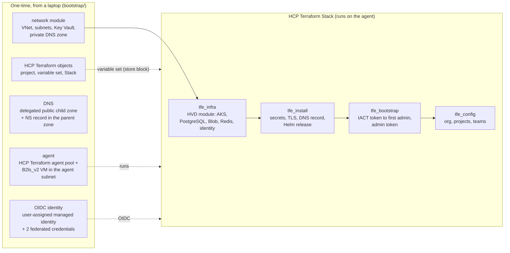
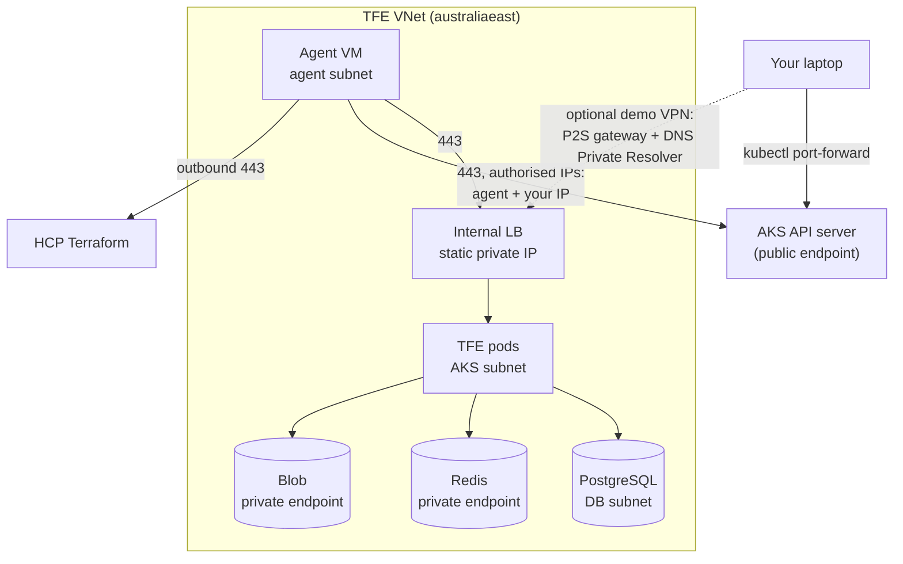
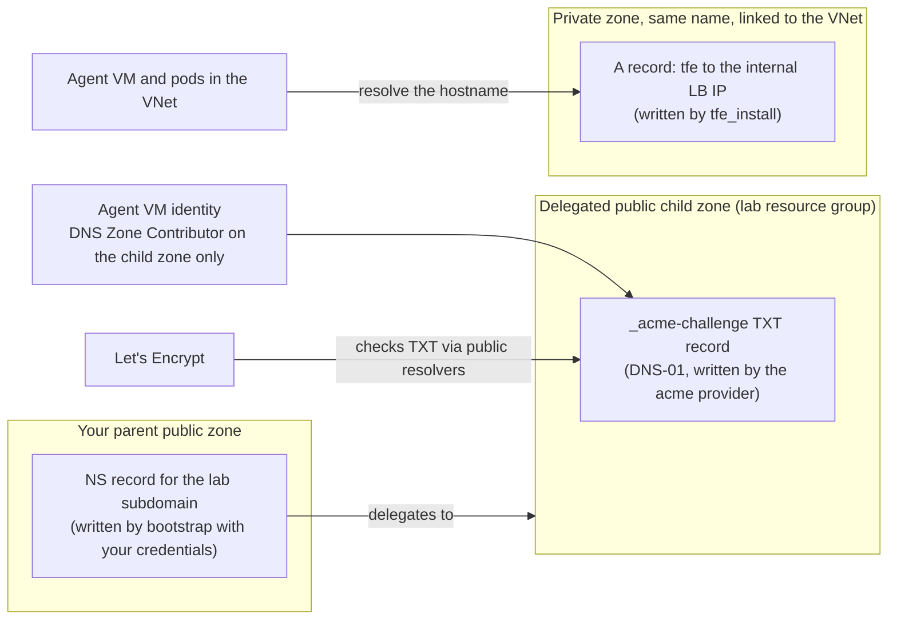

# Architecture

How the pieces fit together. The steps to build it are in the [runbook](runbook.md). What to change for production is in [production.md](production.md).

## Build flow

A one-time `bootstrap/` run from a laptop prepares the Azure and HCP Terraform side. After that, the HCP Terraform Stack runs on the agent VM inside the VNet and builds TFE in four components.

## Network

- TFE, PostgreSQL, Redis and Blob storage have no public inbound endpoint.
- The AKS API server keeps its public endpoint, limited to authorised IP ranges: the agent VM's static public IP and `operator_cidrs`. The HVD module has no private-cluster input. See "Known gaps" in the [README](../README.md).
- Optional demo access: with `enable_demo_vpn = true`, bootstrap adds a point-to-site VPN gateway (`VpnGw1AZ`, OpenVPN, certificate auth) and a DNS Private Resolver inbound endpoint in the same VNet. A laptop on the VPN resolves the private zone through the resolver and opens `https://<tfe hostname>` directly. It mirrors a customer's corporate network, hub and private resolver path, and costs about A$0.65/h while on. See the [runbook](runbook.md#demo-access-through-vpn-optional).
- Without it, you reach the TFE UI with `kubectl port-forward` to the TFE service and a hosts-file entry for the FQDN. The certificate is valid for the FQDN, so the browser trusts it.

## DNS and certificate path

The TFE hostname is `tfe.<lab_subdomain>.<parent zone>`. Two zones with the same name `<lab_subdomain>.<parent zone>` exist, and each has one job.

- Bootstrap creates the child zone in the lab resource group and one NS record for it in the parent zone. The operator's own credentials write that NS record, so the operator needs DNS write access on the parent zone at bootstrap apply and at destroy.
- The agent VM's system-assigned identity has DNS Zone Contributor on the child zone only. It has no role on the parent zone, so runs on the agent cannot change other records.
- The `acme` provider answers the Let's Encrypt DNS-01 challenge in the child zone, using `AZURE_AUTH_METHOD = msi` (the agent VM identity). It sets `recursive_nameservers` to `8.8.8.8:53` and `1.1.1.1:53`, because the agent would otherwise resolve the name from the private zone, which has no TXT record.
- Inside the VNet the private zone shadows the public one (split horizon), so the hostname resolves to the internal load balancer address. From outside, the name does not resolve to anything useful.

## Components

Bootstrap and the network module are not Stack components. The Stack reads their outputs from the HCP Terraform variable set `tfe-aks-inputs` through a `store "varset"` block in `deployments.tfdeploy.hcl`.

| Module | What it creates | Inputs from | Outputs to |
|---|---|---|---|
| `bootstrap/` (root) | Resource group `<prefix>-tfe-rg`; user-assigned managed identity and two federated credentials (plan, apply); Contributor and User Access Administrator on the resource group; consumption budget; delegated child DNS zone, NS record in the parent zone, DNS Zone Contributor for the agent VM identity; HCP Terraform project, agent pool, agent token, variable set, Stack (`tfe_stack`, beta); agent VM with a static public IP | `terraform.tfvars` (see `bootstrap/README.md`) | Variable set (every Stack input); outputs `stack_client_id`, `tfe_hostname`, `agent_public_ip`, `varset_name`, `agent_ssh_private_key` |
| `modules/network` | VNet and five subnets (lb, aks, db, redis, agent); Key Vault (RBAC, default deny, name `<prefix>kv<4 random>`); Key Vault Secrets Officer assignments; 60 s RBAC wait; DB password secret `tfe-db-password`; private DNS zone and VNet link | `bootstrap/` | `tfe_hostname`, `vnet_id`, `lb_subnet_id`, `lb_subnet_name`, `aks_subnet_id`, `db_subnet_id`, `redis_subnet_id`, `agent_subnet_id`, `key_vault_id`, `key_vault_name`, `db_password_secret_name`, `private_dns_zone_name`, `lb_static_ip` |
| `modules/tfe-infra` | Calls `hashicorp/terraform-enterprise-aks-hvd/azurerm` 0.3.0: AKS, PostgreSQL Flexible Server, two Azure Managed Redis instances, storage account and container, workload identity. Reads the cluster back with a data source for `kube_config` (the module's AKS is a local-account cluster with no Entra RBAC profile, so `kube_admin_config` is empty) | Deployment inputs from the variable set; `size` preset | `effective_settings`, `replica_count`, `tfe_pod_requests`, `aks_cluster_name`, `kube_host`, `kube_cluster_ca_certificate`, `kube_client_certificate`, `kube_client_key`, `tfe_database_*`, `tfe_object_storage_azure_*`, `tfe_redis_*`, `tfe_redis_sidekiq_*` |
| `modules/tfe-install` | Namespace `tfe`; Key Vault secrets `tfe-encryption-password`, `tfe-iact-token`, `tfe-tls-fullchain`, `tfe-tls-key`; Kubernetes secrets `tfe-secrets`, `terraform-enterprise` (image pull) and `tfe-certs`; Let's Encrypt certificate; private A record; Helm release `terraform-enterprise` | `tfe_infra` outputs; deployment inputs | `tfe_hostname`, `tfe_url`, `iact_token`, `helm_values_yaml` |
| `modules/tfe-bootstrap` | First site admin through `POST /admin/initial-admin-user` (terracurl, called once); Key Vault secrets `tfe-admin-token` and `tfe-admin-password` | `tfe_install` (`tfe_hostname`, `iact_token`); `admin_email`, `key_vault_id` | `admin_token`, `admin_username` (default `tfeadmin`) |
| `modules/tfe-config` | Organization (cost estimation off, `collaborator_auth_policy`); `platform` project plus any extra projects; `platform` team with admin on the `platform` project; memberships | `organization_name`, `organization_email`, `platform_team_member_emails`, `collaborator_auth_policy`; the `tfe` provider is configured from `tfe_install` and `tfe_bootstrap` outputs | `organization_name`, `project_ids`, `platform_team_id` |

The Stack's own outputs are `tfe_url` and `organization_name`.

The plain CLI path uses the same modules in three roots (`examples/cli/01-infra`, `02-app`, `03-config`). See [examples/cli/README.md](../examples/cli/README.md).

## Sizing and cost

Estimates from the Azure Retail Prices API (`prices.azure.com`, pay-as-you-go, Linux), Australia East, AUD, before GST, checked 2026-10-20. AKS uses the Free tier (the module does not set `sku_tier`). The presets are in `modules/tfe-infra/main.tf`.

| | `lab` | `small` | `production` |
|---|---|---|---|
| AKS default pool | 2 x Standard_D4ds_v5 | 2 x Standard_D8ds_v5 | 3 x Standard_D8ds_v5 |
| TFE node pool | none | none | 3 x Standard_D8ds_v5 |
| TFE pods (`replicaCount`) | 1 | 1 | 3 |
| TFE pod requests (CPU / memory) | 2 / 6Gi (fits D4ds_v5: 3.86 vCPU allocatable; chart default 4 / 8Gi would stay Pending) | 4 / 8Gi | 4 / 8Gi |
| PostgreSQL | GP_Standard_D2ds_v4, HA off | GP_Standard_D4ds_v4, HA off | GP_Standard_D4ds_v4 or larger, HA on |
| Azure Managed Redis (x2) | Balanced_B0, HA off | Balanced_B3, HA on | Balanced_B3 or larger, HA on |
| Storage | ZRS | ZRS | ZRS |
| Approx. A$ per hour (nodes, PostgreSQL, Redis) | 1.2 | 2.6 to 2.7 | depends on sizing |

- `lab` breakdown per hour: nodes 2 x A$0.4046, PostgreSQL 2 vCore x A$0.1738, Redis 2 x A$0.0285 (`Balanced_B0`).
- The agent VM (`Standard_B2ls_v2`) adds about A$0.08 an hour (A$0.0752, about A$55 a month) while it exists.
- Small items (load balancer, public IP, private endpoints, disks, Blob, DNS zones) add roughly A$50 to A$150 a month.
- Bootstrap adds a consumption budget alert on the resource group (alerts at 50% and 90% of `budget_amount`) and tags every resource with `owner` and `expires`.
- `Balanced_B0` is unproven for TFE. The fallback is `Balanced_B1` (A$0.057 an hour each), about A$0.06 an hour more for the pair.
