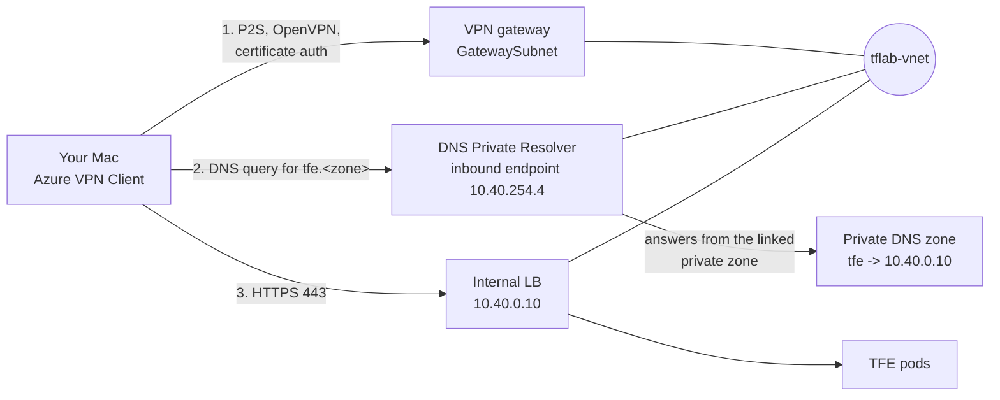

# Runbook

Build, check and destroy a sample environment: Terraform Enterprise (TFE) 2.0.8 on AKS in `australiaeast`, deployed by an HCP Terraform Stack. Read the [architecture](architecture.md) first if you want the picture.

Keep your real subscription, tenant and zone IDs out of this repo. Replace every `<placeholder>` below with your own values. For production guidance see [production.md](production.md).

## 1. Prerequisites

- **Azure subscription.** One you can create resources in. If it has a time limit, finish the build and checks inside it. Keep nothing important only in the subscription.
- **Azure CLI login**, scoped to the right tenant and subscription:

  ```bash
  az login --tenant <tenant-id>
  az account set --subscription <subscription-id>
  ```

  You need Owner on the subscription, because bootstrap creates role assignments.
- **Quota check.** The `lab` preset needs 2 x `Standard_D4ds_v5` for AKS plus the agent VM:

  ```bash
  az vm list-usage -l australiaeast -o table
  ```

  Check for at least 8 free vCPUs in the "Standard Ddsv5 Family vCPUs" row (2 nodes x 4 vCPUs), plus room for the agent VM in the "Standard BS Family vCPUs" row and in the total regional vCPUs.
- **TFE licence file** (`.hclic`) on your laptop. Use your Terraform Enterprise licence.
- **Parent public Azure DNS zone** that you own, for example `example.com`. Bootstrap writes one NS record into it, and removes it at destroy.
  - Your `az login` needs DNS Zone Contributor on the parent zone, in whichever subscription the zone lives.
  - If the zone is in a different subscription from the lab, set `public_dns_zone_subscription_id` in `terraform.tfvars`.
  - If the zone is in a different tenant, set `create_lab_delegation = false` and add the NS record by hand after the apply (see "Manual NS delegation" in step 2).
- **HCP Terraform organisation** with Stacks enabled and a user or team token exported as `TFE_TOKEN`:

  ```bash
  export TFE_TOKEN=<hcp-terraform-token>
  ```
- **GitHub connection.** Use one of two. Either the HCP Terraform GitHub App installed on the repository's owner, with its installation ID (`ghain-...`) in `github_app_installation_id` (find it in HCP Terraform under Settings, Version Control, or with the `tfe_github_app_installation` data source). Or a classic GitHub OAuth connection, with its token ID (`ot-...`) in `vcs_oauth_token_id`. Find the `ot-` ID in the HCP Terraform organisation under Settings, Version Control, Providers: open the GitHub provider and copy the OAuth Token ID. Set exactly one; the plan fails if both or neither are set.
- **Your public IP** for `operator_cidrs`: `curl -s https://ifconfig.me`, then use `<ip>/32`. It must still match when you destroy.
- **Tools on your laptop:** `terraform` (the repo pins 1.16.x in CI), `az`, `kubectl`, `jq`, `curl`, `nc`.

## 2. Bootstrap

Order matters in a live session: create `main` and push it before you apply bootstrap, because the `tfe_stack` resource tracks `main` (see step 3 for the matching rule on the placeholder values).

1. Create `main` from the spec-approval commit and push it:

   ```bash
   git branch main <spec-approval-commit>
   git push origin main
   ```

2. Then run the bootstrap apply below. Set `aks_kubernetes_version`, `admin_email` and `organization_email` on your feature branch before you merge that branch to `main` (step 3), because the merge is what the Stack ingests.

Bootstrap runs once from your laptop with local state. That state holds secrets (agent token, licence, SSH key), so keep `bootstrap/terraform.tfstate` private. Details are in [bootstrap/README.md](../bootstrap/README.md).

```bash
cd bootstrap
cp terraform.tfvars.example terraform.tfvars   # fill in; the file is git-ignored
terraform init && terraform apply
```

Set these in `terraform.tfvars` (the example file lists the required ones): `prefix` (3 to 10 lowercase letters or digits, no `tfe`), `subscription_id`, `operator_cidrs`, `public_dns_zone_name`, `public_dns_zone_resource_group`, `hcp_organization`, one of `github_app_installation_id` or `vcs_oauth_token_id`, `tfe_license_file`, `tfc_agent_version` (1.25.2 or later for Stacks), `owner_tag`, `expires_tag`, `budget_contact_emails`. Optional: `public_dns_zone_subscription_id` (parent zone in another subscription) and `create_lab_delegation = false` (parent zone in another tenant).

`github_branch` defaults to `main`. The Stack reads its configuration from that branch, so the Stack files must be on it. If you work from another branch, set `github_branch` to match.

Bootstrap creates:

- the lab resource group `<prefix>-tfe-rg`, the network, the Key Vault and the private DNS zone;
- a delegated public child zone `<lab_subdomain>.<parent zone>` (default `tfelab`) and one NS record for it in your parent zone;
- a user-assigned managed identity with federated credentials for the Stack, and the agent VM (`Standard_B2ls_v2`, 2 vCPU and 4 GB; some subscriptions restrict B-series SKUs, so check availability in your subscription and region) with its identity;
- the HCP Terraform project (`tfe-on-aks`), agent pool, variable set `tfe-aks-inputs` and the Stack `tfe-aks`.

Allow a few minutes: the Key Vault RBAC wait is 60 seconds, and the agent needs time to register.

Check the result:

```bash
terraform -chdir=bootstrap output
```

(This is the bootstrap output list: `stack_client_id`, `tfe_hostname`, `agent_public_ip`, `varset_name`, `key_vault_name`, `aks_cluster_name`, `lab_dns_zone_name_servers`. The agent SSH key output is sensitive.)

### Manual NS delegation (parent zone in another tenant)

With `create_lab_delegation = false`, bootstrap creates the child zone but no NS record. Read the child zone's name servers, then add the record to the parent zone with an `az` login that has access to that tenant:

```bash
terraform -chdir=bootstrap output -json lab_dns_zone_name_servers

# in the parent zone's tenant and subscription:
az login --tenant <parent-zone-tenant-id>
az account set --subscription <parent-zone-subscription-id>
az network dns record-set ns create -g <parent-zone-rg> -z <parent zone> -n <lab_subdomain> --ttl 300
az network dns record-set ns add-record -g <parent-zone-rg> -z <parent zone> -n <lab_subdomain> -d <name-server-1>
az network dns record-set ns add-record -g <parent-zone-rg> -z <parent zone> -n <lab_subdomain> -d <name-server-2>
az network dns record-set ns add-record -g <parent-zone-rg> -z <parent zone> -n <lab_subdomain> -d <name-server-3>
az network dns record-set ns add-record -g <parent-zone-rg> -z <parent zone> -n <lab_subdomain> -d <name-server-4>
```

Use the four names from `lab_dns_zone_name_servers`, one per `add-record`. Remove the record by hand at destroy (`az network dns record-set ns delete -g <parent-zone-rg> -z <parent zone> -n <lab_subdomain>`).

Then confirm in HCP Terraform that the agent pool shows one idle agent. If you set `create_stack = false`, create the Stack by hand and select that agent pool.

## 3. Pick the AKS version and set real values

`deployments.tfdeploy.hcl` ships with placeholders. Change them before the first run:

| Input | Placeholder | Set it to |
|---|---|---|
| `aks_kubernetes_version` | `"1.35"` | A version AKS offers in the region and TFE 2.0.8 lists as tested (1.35 or 1.36) |
| `admin_email` | `"tfe-admin@example.com"` | A real address for the first site admin |
| `organization_email` | `"tfe-admin@example.com"` | A real address for the organisation |

List what AKS offers:

```bash
az aks get-versions -l australiaeast -o table
```

Make this change on your feature branch and commit it. The merge to `main` is what the Stack ingests, so the real values must be on the branch before that merge. Merge to `main` and push only when they are set.

## 4. Deploy the Stack

The Stack runs on the agent, so nothing else is needed on your laptop. In HCP Terraform, open the Stack `tfe-aks` in project `tfe-on-aks`. A push to the tracked branch starts a configuration and a plan for `deployment "main"`.

Before you approve the first plan, read the planned values for `module.tfe` in the `tfe_infra` component. The unit tests cannot see inside the HVD module, so this is the check that the wiring from `modules/tfe-infra` is right. For the `lab` size, expect:

| Setting | Expected |
|---|---|
| AKS default pool `vm_size` and count | `Standard_D4ds_v5`, 2 |
| TFE node pool | not created |
| PostgreSQL `sku` | `GP_Standard_D2ds_v4`, high availability off |
| Managed Redis `sku` (both instances) | `Balanced_B0`, high availability off |
| Storage account `ip_rules` | the agent public IP and your `operator_cidrs`, without `/32` |
| AKS API authorised ranges | the agent public IP and your `operator_cidrs`, as `/32` |

If the first apply or a destroy fails with a 403 `AuthorizationFailure` on `module.tfe.azurerm_storage_container.tfe`, it is a known race: the storage network rules or the private endpoint were not yet in place when the data-plane call ran. Re-run the plan and apply (or the destroy).

Approve the plan. TFE is configured in two passes, because the `tfe` provider has no deferred-changes support and needs the admin token at plan time.

**Pass 1** (`configure_tfe = false`, as set in the `deployments.tfdeploy.hcl` template): the apply runs `tfe_infra`, `tfe_install` and `tfe_bootstrap`. That builds the infrastructure, installs TFE and creates the first admin. Expect it to take a while, mostly AKS, PostgreSQL and Redis creation.

**Pass 2**: once `tfe_bootstrap` has applied, edit `deployments.tfdeploy.hcl` and set `configure_tfe = true` in `deployment "main"`. Commit, open a PR and merge it to the tracked branch. The new plan adds `tfe_config`, which creates the organization, projects and team.

Deployment inputs worth knowing: `size = "lab"`, `organization_name = "example-org"`, `configure_tfe` (false for pass 1, true for pass 2), and `collaborator_auth_policy = "password"` (see "Known gaps and security notes").

### If the Helm release fails

The release is `atomic`, so a failed install uninstalls itself and the next apply installs again. Check why the pod didn't become ready first (`kubectl -n tfe get pods`, `kubectl -n tfe describe pod -l app=terraform-enterprise`). On D4ds_v5 nodes the chart's default request of 4 vCPU never schedules, which is why the lab preset requests 2 vCPU / 6Gi.

A release left over from before this setting (status `failed`, error `cannot re-use a name that is still in use`) needs a one-time `helm -n tfe uninstall terraform-enterprise`.

### Things to verify in your environment

Check these on your first run:

1. `tfe_stack` (beta) creates the Stack in bootstrap.
2. `tfe_variable_set` with `parent_project_id`, together with `tfe_project_variable_set`, applies without a conflict.
3. `terracurl` retries when TFE returns a status code that is not 200 or 201 (the `tfe_bootstrap` component calls the admin endpoint while TFE is still starting).
4. `Balanced_B0` Redis is enough for TFE. If not, change the `lab` preset `redis_sku` to `Balanced_B1` (about A$0.06 an hour more).
5. The `Standard_B2ls_v2` agent (2 vCPU, 4 GB) copes with Stack plans. If not, pick a larger size in `agent_vm_size`.
6. Resolved: with `EnterpriseCluster` Redis, Sidekiq logged `CROSSSLOT Keys in request don't hash to the same slot` and runs stayed `pending` while readiness still passed. The vendored HVD module now creates `NoCluster` Redis, and `scripts/acceptance.sh` applies a real run to catch this.

### If TFE is down (plan fails reaching TFE)

The Stack's `tfe` provider has to reach TFE at plan time, so while TFE is down every plan fails (`failed to request discovery document ... Client.Timeout`) and the fix in `tfe_install` can't apply. This happened when Redis was recreated: the TFE pod kept the old Redis keys.

1. Find why the pod is not Ready: `kubectl -n tfe get pods`, `kubectl -n tfe logs deploy/terraform-enterprise`.
2. If a secret is stale, put the right values into the `tfe-secrets` Kubernetes secret (for Redis, the `primaryKey` from `az redisenterprise database list-keys`), then `kubectl -n tfe rollout restart deployment/terraform-enterprise` and wait for Ready.
3. Rerun the deployment: `terraform stacks deployment-group rerun -deployment-group-id <id> -deployment-names lab`. The plan then writes the same values back, so Terraform owns the secret again.

To avoid this, plan any change that recreates Redis or PostgreSQL knowing TFE will restart, and consider moving `tfe_config` to its own Stack so infrastructure fixes never need TFE to be up.

## 5. Reach the UI

TFE has only an internal load balancer. From your laptop, go through the AKS API (your IP is authorised) with a port-forward.

Find the names from the bootstrap outputs (the resource group is `<prefix>-tfe-rg`):

```bash
terraform -chdir=bootstrap output -raw tfe_hostname
terraform -chdir=bootstrap output -raw aks_cluster_name
terraform -chdir=bootstrap output -raw key_vault_name
```

Then:

```bash
az aks get-credentials -g <prefix>-tfe-rg -n "$(terraform -chdir=bootstrap output -raw aks_cluster_name)" --admin --overwrite-existing
kubectl -n tfe port-forward svc/terraform-enterprise 8443:443
```

Add a hosts entry, with the hostname from `terraform output -raw tfe_hostname` (`tfe.<lab_subdomain>.<parent zone>`):

```text
127.0.0.1 tfe.<lab_subdomain>.<parent zone>
```

Open `https://tfe.<lab_subdomain>.<parent zone>:8443`. The certificate is valid for the name, so the browser trusts it. Sign in as `tfeadmin`. The password is in Key Vault:

```bash
az keyvault secret show --vault-name "$(terraform -chdir=bootstrap output -raw key_vault_name)" -n tfe-admin-password --query value -o tsv
```

Your IP must be in `operator_cidrs`, because the Key Vault firewall allows only that, the AKS subnet and the agent subnet.

## Demo access through VPN (optional)

For a realistic demo you can open `https://<tfe hostname>` in a normal browser, with no port-forward and no hosts entry. Your Mac joins the VNet over a point-to-site VPN and asks an Azure DNS Private Resolver for the private zone. This is the same path a customer uses: corporate network, then hub, then private resolver.



Turn it on. It is off by default and adds nothing to the plan until you do:

```bash
echo 'enable_demo_vpn = true' >> bootstrap/terraform.tfvars
terraform -chdir=bootstrap apply
```

The VPN gateway takes 30 to 45 minutes to create. The apply also makes a short-lived root CA and client certificate (30 days) with the `tls` provider; the keys sit in the local bootstrap state like the other bootstrap secrets.

Build the Mac profile. The script asks for an export password for the `.p12`, then writes everything to the git-ignored `demo-vpn/` directory:

```bash
./scripts/demo-vpn-profile.sh
```

On the Mac:

1. Install "Azure VPN Client" from the Mac App Store.
2. Double-click `demo-vpn/client.p12` and import it into the login keychain.
3. In Azure VPN Client, import `demo-vpn/azurevpnconfig.xml`, choose the `demo-vpn-client` certificate, save and connect.
4. Open `https://tfe.<lab_subdomain>.<parent zone>`.

Cost while it is on: about A$0.30/h for the gateway plus about A$0.35/h for the resolver inbound endpoint (A$256 a month), so about A$0.65/h. Turn it off when the demo is done:

```bash
# remove the enable_demo_vpn line from bootstrap/terraform.tfvars (or set it to false), then:
terraform -chdir=bootstrap apply
rm -rf demo-vpn
```

## 6. Acceptance

`scripts/acceptance.sh` checks pods, readiness over a verified certificate, the admin token, the organisation and the `platform` team. It does its own port-forward on local port 8443, so stop any port-forward from step 5 first. It needs `az` (logged in), `kubectl`, `jq`, `curl` and `nc`, and your IP in the AKS and Key Vault allow-lists.

```bash
./scripts/acceptance.sh \
  --rg <prefix>-tfe-rg \
  --aks <aks-name> \
  --hostname tfe.<lab_subdomain>.<parent zone> \
  --key-vault <key-vault-name> \
  --org example-org
```

Add `--admin-user <name>` if the admin account is not `tfeadmin`. `-h` prints usage.

It exits 0 and prints `ALL CHECKS PASSED` only if every check passes. Each check prints `PASS:` or `FAIL:`.

Run the acceptance script at the end of a build, not in CI.

## 7. IACT window recovery

The first admin is created with a preset initial admin creation token (IACT). TFE accepts it for `TFE_IACT_TIME_LIMIT` minutes after the pods start (default 60). The `tfe_bootstrap` component calls the endpoint right after the Helm release is ready, and retries 10 times, 30 seconds apart.

If the run failed after the window closed, restart the pods to reopen it, then re-run the Stack:

```bash
kubectl -n tfe rollout restart deployment/terraform-enterprise
kubectl -n tfe rollout status deployment/terraform-enterprise
```

Then trigger a new plan and apply of the deployment in HCP Terraform. The admin call is made only once. If it already succeeded, nothing is repeated.

## 8. Let's Encrypt limits

- Let's Encrypt allows 5 duplicate certificates per week for the same name. A build and a rebuild use two, because destroy revokes the certificate and the rebuild issues a new one. Plan at most two acceptance rebuilds a week.
- Never change the ACME server URL on a live deployment. It breaks the ACME registration in state. The Stack uses Let's Encrypt production from its first run. A staging certificate is untrusted, so `tfe_bootstrap` and the `tfe` provider would fail with it.
- The certificate renews on a Stack re-run when fewer than 30 days remain.

## 9. Destroy

Order matters: the Stack first, then bootstrap.

1. In `deployments.tfdeploy.hcl`, set `destroy = true` on `deployment "main"`. Commit, push to the tracked branch, and approve the destroy plan in HCP Terraform.
2. Wait for the deployment to be empty.
3. Destroy bootstrap:

   ```bash
   terraform -chdir=bootstrap destroy
   ```

   Your current public IP must still match `operator_cidrs` in `terraform.tfvars`, or the Key Vault calls are refused. You also need DNS write access on the parent zone, because destroy removes the NS record.

Afterwards, delete your local `bootstrap/terraform.tfstate` files if you no longer need them, because they hold secrets. Remove the hosts-file entry too.

If you rebuild with the same inputs straight away, the Key Vault name is new each time (random suffix), so soft-deleted vaults don't collide.

After a bootstrap destroy and rebuild, the child zone gets a new set of name servers. Public resolvers may cache the old NS set for up to 2 days (TTL 172800), so the DNS-01 challenge can fail until the cache expires. This does not affect Stack-only rebuilds, which keep the same child zone.

## 10. Cost and budget

Figures are estimates from the Azure Retail Prices API (`prices.azure.com`, pay-as-you-go, Linux), Australia East, AUD, before GST, checked 2026-10-20. Re-check them for your agreement and region.

| | |
|---|---|
| `lab` preset (AKS nodes, PostgreSQL, 2 x Redis) | about A$1.2 an hour |
| Agent VM (`Standard_B2ls_v2`) | about A$0.08 an hour (about A$55 a month). Some subscriptions restrict B-series SKUs; check availability in your subscription and region. |
| Small items (load balancer, IPs, private endpoints, disks, Blob, DNS) | about A$50 to A$150 a month |
| A forgotten lab | about A$35 a day |

Bootstrap creates a budget on the resource group (`budget_amount`, default 500 in the billing currency) with email alerts at 50% and 90%. Every resource carries `owner` and `expires` tags. Set `expires_tag` honestly, and destroy the lab when you finish. Don't rely on the subscription's TTL to clean up, because the Stack state and HCP Terraform objects live outside the subscription.

## 11. Plain CLI path

The same modules run without Stacks, in three roots: `examples/cli/01-infra`, `02-app` and `03-config`. They need a machine inside the VNet for `02-app` and `03-config`. Steps are in [examples/cli/README.md](../examples/cli/README.md).

## Known gaps and security notes

- **No AKS network policy (AZU-0043).** HashiCorp's HVD module 0.3.0 has no `network_policy` input, so pod-to-pod traffic is not restricted by Kubernetes network policy. `.trivyignore` ignores the finding on purpose. Revisit when the module adds the input or when support for using an existing AKS cluster is added.
- **Lab sign-in policy.** `modules/tfe-config` defaults `collaborator_auth_policy` to `two_factor_mandatory`. The sample Stack deployment (and `examples/cli/03-config`) set `"password"`, because the bootstrap admin's API token user has no 2FA. To move to `two_factor_mandatory`, every owner, including the bootstrap admin, must enrol 2FA first, or you move to SSO.
- **Parent-zone write access.** The operator needs DNS Zone Contributor on the parent DNS zone (in whichever subscription it lives) at bootstrap apply and at destroy, for the NS record. The agent VM identity has DNS Zone Contributor on the child zone only.
- **Wiring is checked at plan review.** `terraform test` cannot see child-module resources, so the values passed from `tfe-infra` into the HVD module are not unit-tested. Do the plan review in step 4 before approving the first plan.
- **AKS API exposure.** The API server has a public endpoint, limited to the agent VM's public IP and your `operator_cidrs`. This is acceptable for a sample environment. A private API server is not supported yet, because an existing AKS cluster cannot be used.
- **Secrets in state.** Bootstrap local state, Stack state and the agent VM's `custom_data` contain secrets. Treat them accordingly.
- **Community module.** The HVD module is community-maintained code, not covered by product support. It is not covered by product support.
- **Stack identity scope.** The Stack identity has Contributor on its own resource group, plus Role Based Access Control Administrator limited by an ABAC condition to assigning only Network Contributor and Storage Blob Data Owner (it cannot grant Owner or other roles). The resource group still includes the agent VM, so a Stack run could run commands on the agent. For production, put the identity and the agent in separate resource groups.
- **`.trivyignore` is repo-wide.** It ignores AZU-0043 for every configuration in the repo. Re-check AZU-0043 when support for using an existing AKS cluster is added.
